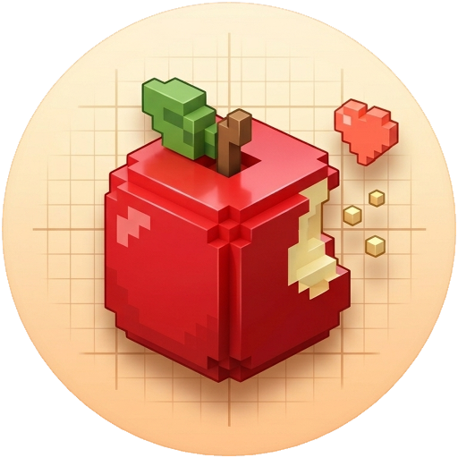

  

<h1 align="center">Share a Bite</h1>

  Hold right-click to share food with friends in <strong>Minecraft 1.20.1 (Forge)</strong> — standalone, anti-grief, and food-mod friendly.

  <a href="README.md">简体中文</a> ·
  <strong>English</strong> ·
  <a href="https://github.com/PixelMC-Projects/Share-a-Bite/issues">Report Issues</a> ·
  <a href="LICENSE">Apache-2.0</a>

---

Welcome to **Share a Bite**, a lightweight standalone player-to-player feeding mod designed for cozy multiplayer survival servers.

Instead of instant right-click feeding that makes prank foods effortless, **Share a Bite** uses a deliberate hold-to-feed interaction with live recipient warnings, per-player permissions, native eating feedback, and automatic compatibility with food-progression mods—with **zero external mod dependencies**.

## Highlights

| Feature | How it works |
| --- | --- |
| **Hold to Feed** | Hold right-click on another player with food in your main hand; keep holding to feed another portion. Releasing, looking away, or switching slots cancels without consuming food. |
| **Anti-Grief Warning** | Recipients see a subtle ActionBar notice (`<player> is feeding you <food>`) while a feed is charging, giving them time to step away from prank items. |
| **Player Permissions** | Built-in scrollable permissions screen (unbound keybind by default) lets each player allow or deny specific players, persisted per world by UUID. |
| **Native Feedback** | Plays vanilla eating/drinking sounds and spawns food-crumb particles near the recipient during charging and completion. |
| **Food-Mod Friendly** | Fires Forge’s standard `onItemUseFinish` event for the recipient—mods like **Spice of Life: Carrot Edition**, **Farmer’s Delight**, and **Diet** automatically credit food progress, bonuses, and container returns (bowls/bottles). |

## Installation & Usage

Install on **both the server and clients** (Minecraft `1.20.1` · Forge `47.3.33+`).

1. Hold any edible item in your main hand, look at another player, and hold right-click.
2. Bind **Open feeding permissions** in Controls if you want quick access to your personal permission list.

## Server Configuration (`shareabite-server.toml`)

| Option | Default | Description |
| --- | --- | --- |
| `maxTargetHunger` | `20` | Players can only be fed when hunger is strictly below this value (`1–21`; set `21` to allow feeding at full hunger). |
| `allowAlwaysEdibleWhenFull` | `true` | Allows always-edible items (e.g. Golden Apples, Honey Bottles, Chorus Fruit) even when full. |
| `requireSneakToFeed` | `false` | Require holding sneak while holding right-click to feed another player. |
| `holdDurationMultiplier` | `1.0` | Multiplier on vanilla food use duration (`0.1–5.0`). |
| `targetCooldownTicks` | `20` | Minimum ticks between completed feeds on the same recipient (`0–1200`). |
| `foodBlacklist` | `[]` | Item IDs that cannot be fed. Also supports datapack item tag `#shareabite:unfeedable`. |

---

  Original author: <a href="https://github.com/PixelMC-Projects">zcpu · PixelMC</a> · Licensed under <a href="LICENSE">Apache-2.0</a>

