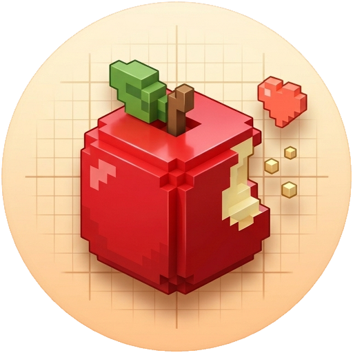

  

<h1 align="center">Share a Bite · 分你一口</h1>

  面向 <strong>Minecraft 1.20.1（Forge）</strong> 的轻量独立玩家投喂模组——长按投喂、防恶搞提醒、零硬依赖。

  <strong>简体中文</strong> ·
  <a href="README.en.md">English</a> ·
  <a href="https://github.com/PixelMC-Projects/Share-a-Bite/issues">反馈问题</a> ·
  <a href="LICENSE">Apache-2.0</a>

---

欢迎使用 **Share a Bite（分你一口）**——一款为联机养老生存服打造的独立玩家互相投喂模组。

相比「右键秒喂」容易被朋友拿腐肉或河豚恶搞的设计，**Share a Bite** 采用需要持续按住的「长按投喂」交互，自带被喂方实时提醒、个人许可面板与原版进食音效粒子反馈，并天然兼容主流食物模组——**无需任何外部前置模组，开箱即用**。

## 核心特性

| 特性 | 说明 |
| --- | --- |
| **长按投喂** | 主手拿食物对准玩家长按右键即可喂食，持续按住可连续喂下一份；中途松手、移开准星或切槽自动取消且不消耗食物。 |
| **防恶搞实时提醒** | 读条期间被喂方底部会收到轻提示（`xxx 正在喂你 [食物]`），看到恶搞食物来得及躲开。 |
| **个人许可面板** | 内置可搜索翻页的许可面板（快捷键默认未绑定，可在按键设置中配置），每位玩家可独立控制允许谁给自己投喂，按 UUID 持久化保存。 |
| **原版进食反馈** | 读条与喂食完成时在被喂玩家嘴边播放轻柔的咀嚼/饮用音效与对应食物碎屑粒子。 |
| **自动兼容食物模组** | 喂食完成时按 Forge 标准 `onItemUseFinish` 事件触发，装有 **生活调味料：胡萝卜版（SOL: Carrot）**、**农夫乐事**、**Diet** 等模组时自动计入食物进度、效果与碗/瓶返还。 |

## 安装与使用

服务端与客户端均需安装（Minecraft `1.20.1` · Forge `47.3.33+`）。

1. 主手手持食物，对准其他玩家长按右键即可投喂。
2. 如需管理谁可以给你投喂，可在游戏「按键设置」中为「打开投喂许可面板」绑定快捷键。

## 服务端配置（`shareabite-server.toml`）

| 配置项 | 默认值 | 说明 |
| --- | --- | --- |
| `maxTargetHunger` | `20` | 目标饱食度严格低于该值时才可投喂（`1–21`，设为 `21` 允许满饱食度尝鲜）。 |
| `allowAlwaysEdibleWhenFull` | `true` | 允许金苹果、蜂蜜瓶、紫颂果等满腹可食用物品直接投喂。 |
| `requireSneakToFeed` | `false` | 开启后必须「潜行 + 长按右键」才触发投喂，防止与其他右键交互模组冲突。 |
| `holdDurationMultiplier` | `1.0` | 长按读条时长倍率（`0.1–5.0`，`1.0` 为原版进食时长）。 |
| `targetCooldownTicks` | `20` | 同一受喂玩家两次投喂间的最小冷却 tick（`0–1200`）。 |
| `foodBlacklist` | `[]` | 禁止投喂的物品 ID 列表；同时也支持数据包物品标签 `#shareabite:unfeedable`。 |

---

  原作者：<a href="https://github.com/PixelMC-Projects">zcpu · PixelMC</a> · 基于 <a href="LICENSE">Apache-2.0</a> 协议开源

